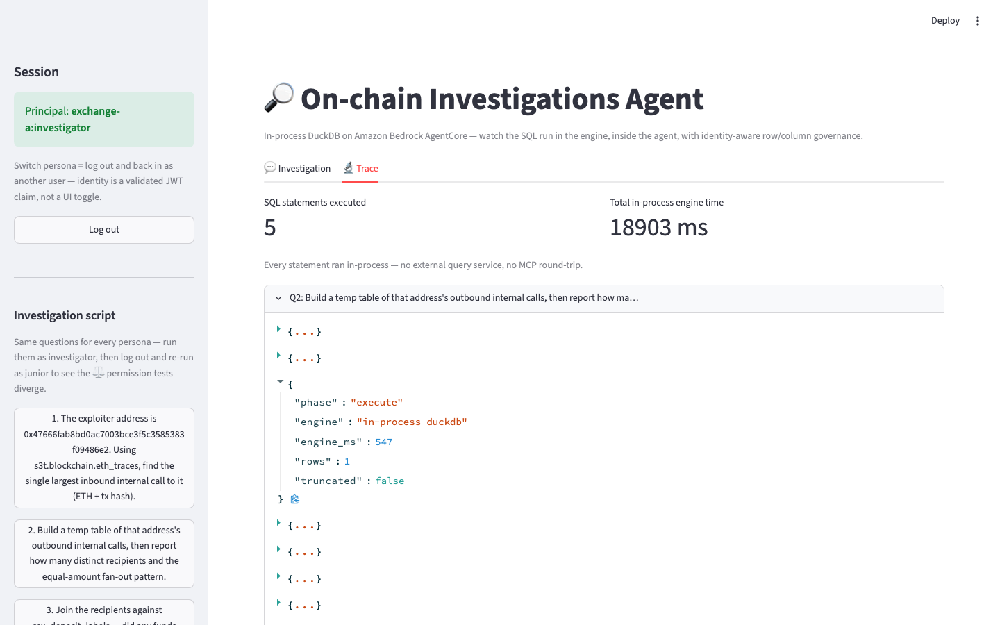

# Data Agent on DuckDB

A data agent with an **in-process DuckDB** engine that queries data directly
on Amazon S3 — no cluster, no warehouse, no ETL. Built on Amazon Bedrock
(Claude) and AgentCore, the solution implements four S3 table-access methods
behind one engine, an engine-neutral identity-aware row/column-level
governance layer in front of it, and a streaming chat UI that shows every
SQL statement running in-process, live. It ships with an on-chain
investigation demo scenario, but the architecture is a general-purpose data
agent: point it at your own S3 tables and policies.

> [!WARNING]
> This is a reference implementation, provided as is. Before production use,
> add monitoring/alerting, rate limiting, HA, fine-grained audit trails, and
> hardened credential rotation for your environment. The exchange/entity
> attribution labels shipped with the demo scenario are **synthetic sample
> data**, not real attribution (the OFAC sanctioned-address list is real and
> cited below).

## The four-layer architecture

A traditional database owns everything: storage, catalog, permissions,
scheduling, and execution. This solution keeps only execution in-process and
externalizes the rest — the same architectural idea behind Amazon Quick's
DuckDB integrations (2.5B+ queries):

| Layer | Lives in | How |
|---|---|---|
| **State** | Amazon S3 | Parquet / Iceberg tables, durable and shared; session working sets are in-memory temp tables that die with the session |
| **Governance** | SQL-rewrite layer (`governance.py`) | Engine-neutral RLS/CLS enforcement *before* the SQL reaches the engine, driven by verified identity claims |
| **Scheduling** | Agent platform (AgentCore) | One session = one microVM = one engine; the platform's session management *is* the resource management |
| **Compute** | In-process DuckDB | The only thing left inside the agent — exactly where the agent's feedback loop needs it |


<details>
<summary>Architecture (text version)</summary>

```
Streamlit UI ──▶ AgentCore Runtime (1 session = 1 microVM = 1 DuckDB)
  (Cognito JWT)   ├─ AuthN: inbound JWT authorizer → claims {tenant, role}
   SSE stream ◀── ├─ AuthZ: governance.py — principal→role→policy,
                  │         sqlglot RLS/CLS rewrite BEFORE the engine
                  ├─ Strands Agent + Bedrock Claude (writes SQL, reads results)
                  └─ DuckDB in-process (httpfs/iceberg/ducklake extensions)
                       ├─ Path A: raw Parquet   — S3 path glob (public dataset)
                       ├─ Path B: S3 Tables     — native Iceberg REST catalog
                       ├─ Path C: Glue catalog  — same table, federated endpoint
                       └─ Path D: DuckLake      — SQL-database catalog, Parquet on S3
Aux: IAM execution role (least privilege) · CloudWatch Logs
The UI renders each run_sql as a live gate → govern → execute trace with
in-process engine_ms — the trace events stream back over the same SSE channel.
```
</details>

## Why in-process

AWS announced the acquisition of DuckLabs (2026-08-26) noting that *"90%+ of
data queries involve 1TB of data or less"* and that DuckDB is *"naturally
optimized for AI agents to use"*. An agent's workload rewards locality:

| Mechanism | Why a remote query service can't give you this |
|---|---|
| **Millisecond feedback loop** | Agents iterate (DESCRIBE → sample → fix error → aggregate), 5-10 SQL per question. In-process failures cost ms and zero tokens; per-query service overhead is paid on every retry. |
| **Session state** | Intermediate results are in-process temp tables; "grab a subset, then reason over it" costs nothing. Remote calls are stateless. |
| **Blast radius** | Agent-generated SQL never touches shared production infra. Worst case: one session OOMs itself. Credentials: read-only. |
| **No second scheduler** | The agent platform's session scheduling *is* the resource management. No queue, no workload groups, no tenant arbitration. |

**When NOT to use this pattern**: data already lives in a governed warehouse
(connect to it directly), or single queries scan multi-TB working sets
(distributed engines exist for a reason). See [docs/design.md](docs/design.md)
for the decision table.

## S3 access methods

Same engine, same agent code — only how a table name resolves to files
differs. Raw Parquet is always on; the others mount `READ_ONLY` when their
env var is set:

| Path | Access method | Alias | Resolution | Env toggle |
|---|---|---|---|---|
| **A** | Raw Parquet | views / `read_parquet` | S3 path glob + LIST | (always on) |
| **B** | S3 Tables (Iceberg REST) | `s3t.*` | S3 Tables native endpoint | `S3_TABLES_ARN` |
| **C** | Glue Data Catalog (Iceberg REST) | `glue.*` | Glue endpoint, federated `s3tablescatalog` | `GLUE_CATALOG` |
| **D** | DuckLake | `dl.*` | SQL catalog database, Parquet on S3 | `DUCKLAKE_CATALOG` |

Paths B and C resolve the *same physical Iceberg table* through two different
endpoints (engine-direct IAM vs organization-wide catalog). Path D defaults
to a single-file catalog on S3; a PostgreSQL catalog form is supported for
multi-writer estates (see `docs/design.md`).

## An engine-neutral SQL governance layer

Fine-grained governance lives in an **engine-neutral SQL rewrite layer** in
front of DuckDB — the same query-rewrite pattern BI platforms use ahead of
embedded engines. Because it operates on the SQL itself (a sqlglot AST
rewrite) rather than inside any particular engine, the same policies govern
every access path uniformly — raw Parquet, S3 Tables, Glue, DuckLake — and
the layer ports to any SQL engine you embed. Enforcement happens *before*
the engine sees a statement, so the engine never executes ungoverned SQL for
a restricted principal, and every decision is visible in the streaming
trace. Authentication and authorization are two layers with one narrow
contract (verified claims):

- **AuthN** — AgentCore's inbound JWT authorizer validates tokens before
  agent code runs; the ID token's `custom:tenant`/`custom:role` claims map to
  a policy. Deployed here with an Amazon Cognito user pool (CDK-provisioned;
  `agentcore configure --authorizer-config` wires it to the runtime).
  No-token and forged-token requests are rejected by the platform before
  agent code runs. For local/CLI use a SigV4 path accepts a payload identity
  asserted by the calling application.
- **AuthZ** — `governance.py` maps principal → role → policy, then rewrites
  every statement with sqlglot: RLS predicates ANDed in, denied columns
  `EXCLUDE`d; explicitly selecting a denied column returns a clean policy
  rejection naming the column and role; raw file access (`read_parquet` and
  every other file-reading table function) is rejected via an AST-shape
  allowlist. Fail-closed on unparseable input; an unknown role falls back to
  its tenant's *most restricted* policy.
- **Policies are configuration** (`GOVERNANCE_POLICIES` env, JSON): per-table
  `row_filter` / `deny_columns` + an `allow_raw_paths` switch, keyed by
  `tenant:role`.
- Applies identically across all four access methods (policy matches the
  logical table name), and the streaming trace labels every decision — which
  row filter, which hidden column, or the rejection.

## Prerequisites

- Python 3.11–3.13 (3.14 lacks prebuilt duckdb wheels)
- An AWS account with Amazon Bedrock model access (Claude) in your region
- AWS CDK v2 (`npm i -g aws-cdk`) for infrastructure deployment
- AWS credentials configured (`aws sts get-caller-identity` works)

## Deploy

```bash
# 1. Infrastructure (S3 Tables bucket, DuckLake bucket, Cognito pool, exec role, logs)
cd infra && pip install -r requirements.txt && cdk deploy
# outputs: TableBucketArn, GlueCatalogId, DuckLakeCatalog, LabelsPrefix,
#          ExecutionRoleArn, CognitoDiscoveryUrl, CognitoAudience

# 2. Load the sample data (DuckDB itself writes the Iceberg table — no Spark/Glue job)
#    Run on AWS-side compute for speed (reads the public us-east-2 dataset over the backbone).
cd .. && python3.13 -m venv .venv && ./.venv/bin/pip install -r requirements.txt
./.venv/bin/python scripts/load_s3tables.py \
    --table-bucket-arn <TableBucketArn> --ducklake <DuckLakeCatalog> \
    --labels-prefix <LabelsPrefix> --days 2025-02-21:2025-02-23

# 3. Agent runtime (configure the inbound JWT authorizer from the Cognito outputs)
./.venv/bin/pip install bedrock-agentcore-starter-toolkit
./.venv/bin/agentcore configure --entrypoint agent.py --name duckdb_analyst \
    --execution-role <ExecutionRoleArn> --region <your-region> --non-interactive \
    --authorizer-config '{"customJWTAuthorizer":{"discoveryUrl":"<CognitoDiscoveryUrl>","allowedAudience":["<CognitoAudience>"]}}' \
    --request-header-allowlist Authorization
./.venv/bin/agentcore launch --env S3_TABLES_ARN=<TableBucketArn> \
    --env GLUE_CATALOG=<GlueCatalogId> --env DUCKLAKE_CATALOG=<DuckLakeCatalog> \
    --env LABELS_PREFIX=<LabelsPrefix>

# 4. Chat UI (Cognito login → streamed reasoning + live gate→govern→execute trace)
cd ui && pip install -r requirements.txt
COGNITO_CLIENT_SECRET=<secret> AGENT_REGION=<your-region> streamlit run app.py
```

Local one-shot mode (no runtime deployment): `./.venv/bin/python agent.py "your question"`
resolves identity from a payload `identity` object; the deployed runtime uses the
Cognito JWT. Copy `.env.example` to set the optional path/label toggles.

> On `allowedAudience` vs `allowedClients`: Cognito puts custom attributes
> (`custom:tenant` / `custom:role`) in the **ID token**, whose `aud` claim is
> the app client id — so the authorizer must validate `allowedAudience` and the
> client must send the **ID token** as the bearer. `allowedClients` validates
> the `client_id` claim, which only the access token carries (and it has no
> custom attributes).

## How to use it

**The demo scenario: on-chain fund-flow investigation.** The pattern needs a
workload that is iterative and multi-hop, not dashboard-shaped — and on-chain
investigation is exactly that: each query depends on what the last one
returned, and the analyst reuses a case-scoped working set dozens of times.
The demo runs on public Ethereum data (`s3://aws-public-blockchain`) around a
real publicly-reported incident: anchor on the drainer address, find the
~401K ETH inbound internal call (invisible in the top-level `transactions`
table), `CREATE TEMP TABLE` its outbound calls once, interrogate the fan-out
(40 × 10,000 ETH) at sub-5ms, then attribute the endpoints against a real
OFAC list and synthetic exchange deposit labels. **To adapt the solution to
your own data**, swap the views in `data_catalog.py`, the load script, and
the policy table — the agent, governance, and UI code are scenario-agnostic.

Log in to the Streamlit UI as a persona and follow the sidebar's shared
5-question investigation script — the same script for every persona, so
switching users shows exactly where governance changes the outcome:


Every `run_sql` renders as a card with the SQL and its
`gate → govern → execute` pipeline — `execute` badged with the in-process
engine time. After the working set is built, follow-ups run at single-digit
milliseconds with zero S3 re-scans:


The **Trace** tab reconstructs the full pipeline and totals the in-process
engine time across the session:



Switch persona (log out, log in — identity is a validated JWT claim, not a
UI toggle) and run the same permission-test question: the junior role gets a
clean policy rejection for the `subject_identity` column, and only ever sees
its own tenant's rows:


You can also drive the runtime headlessly with `scripts/stream_smoke.py`
(SigV4) or `scripts/jwt_invoke.py` (Cognito login + bearer token).

## Project structure

| Path | What |
|---|---|
| `agent.py` | Strands agent + gated streaming `run_sql` DuckDB tool; async SSE entrypoint + local CLI |
| `governance.py` | Identity-aware authorization: principal→role→policy + sqlglot RLS/CLS rewrite |
| `data_catalog.py` | Dataset + label-table catalog + query-cost discipline injected into the system prompt |
| `ui/` | Streamlit chat UI: Cognito login, streamed reasoning, live gate→govern→execute trace, Trace tab |
| `infra/` | CDK app: S3 Tables bucket, DuckLake bucket, Cognito pool, least-privilege execution role |
| `scripts/load_s3tables.py` | One-command data load — DuckDB writes Iceberg via S3 Tables REST + label tables |
| `scripts/stream_smoke.py` | Consume the SSE stream over SigV4 — repeatable streaming acceptance |
| `scripts/jwt_invoke.py` | Cognito login + raw-HTTPS bearer invoke — the production auth path |
| `scripts/ab_compare.py` | Reproduce the in-process vs. query-service comparison table |
| `scripts/cleanup.sh` | Tear everything down (runtime + stack + data) |
| `tests/unit/` | Unit tests (SQL gate, governance rewrite, streaming envelopes, path toggles, concurrency) — no network needed |
| `docs/threat-model/` | Threat model (Threat Composer format + report): threats, mitigations, trust boundaries |
| `docs/design.md` | Design notes: invariants, value props, decision table |

## Cost

Main cost drivers: Amazon Bedrock model invocations (per token), AgentCore
Runtime session compute (per consumption), S3 requests/storage for the sample
dataset (a few GB), and S3 Tables storage/maintenance. There are no always-on
compute resources; idle cost is storage only. Estimate with the
[AWS Pricing Calculator](https://calculator.aws/) for your region and usage.

## Cleanup

```bash
./scripts/cleanup.sh        # agentcore runtime + data + cdk destroy
```

## Security

See [CONTRIBUTING](CONTRIBUTING.md#security-issue-notifications) for how to
report security issues. Do not create public GitHub issues for security
findings.

## License

MIT-0. See [LICENSE](LICENSE).
