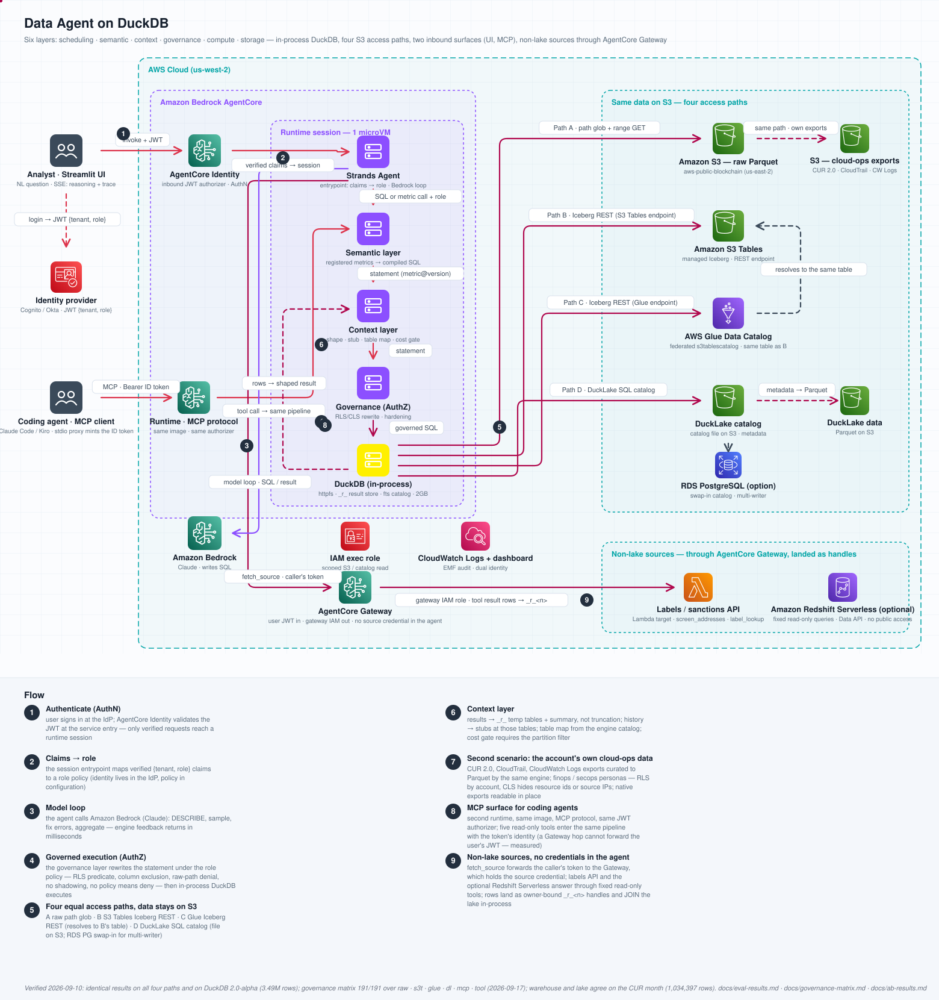
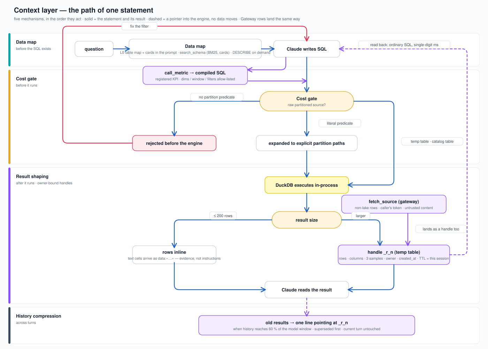
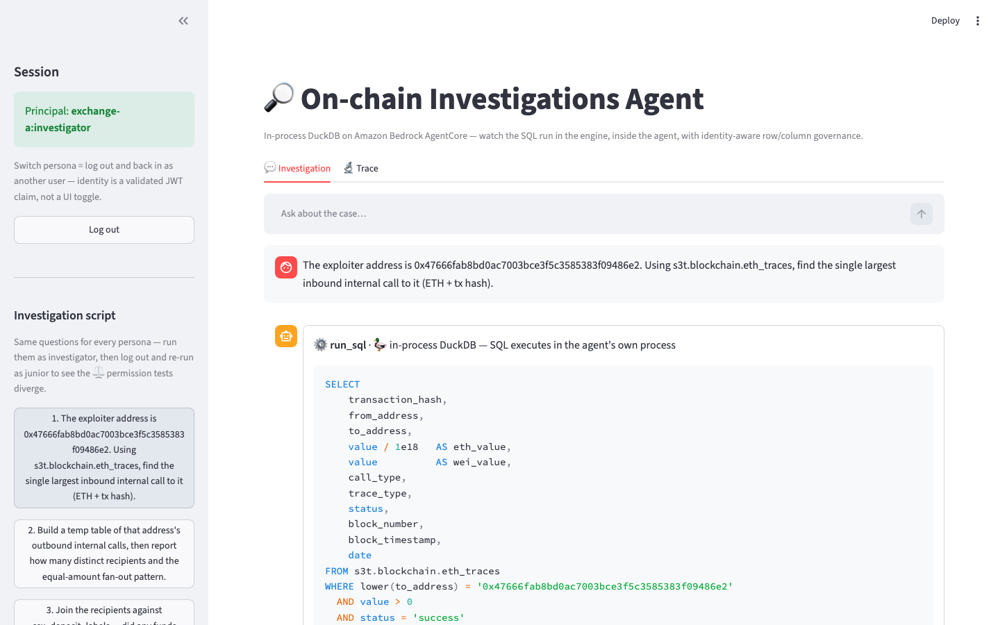
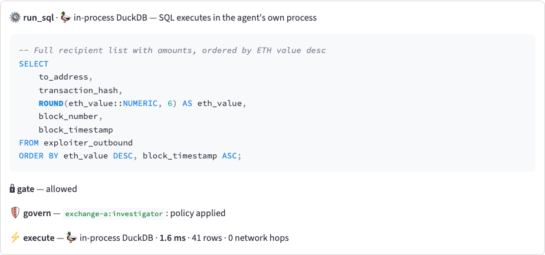
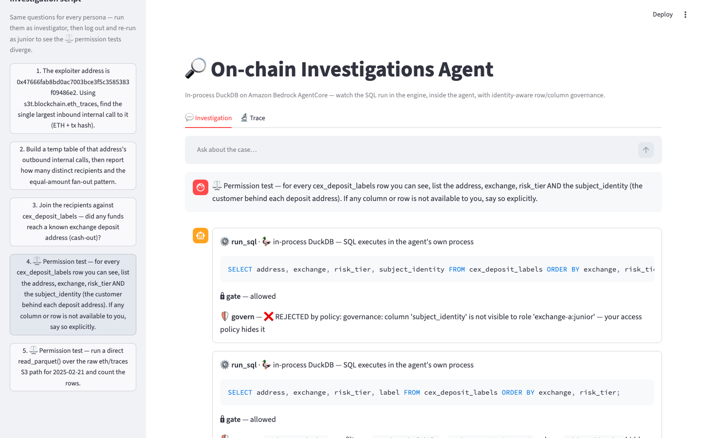
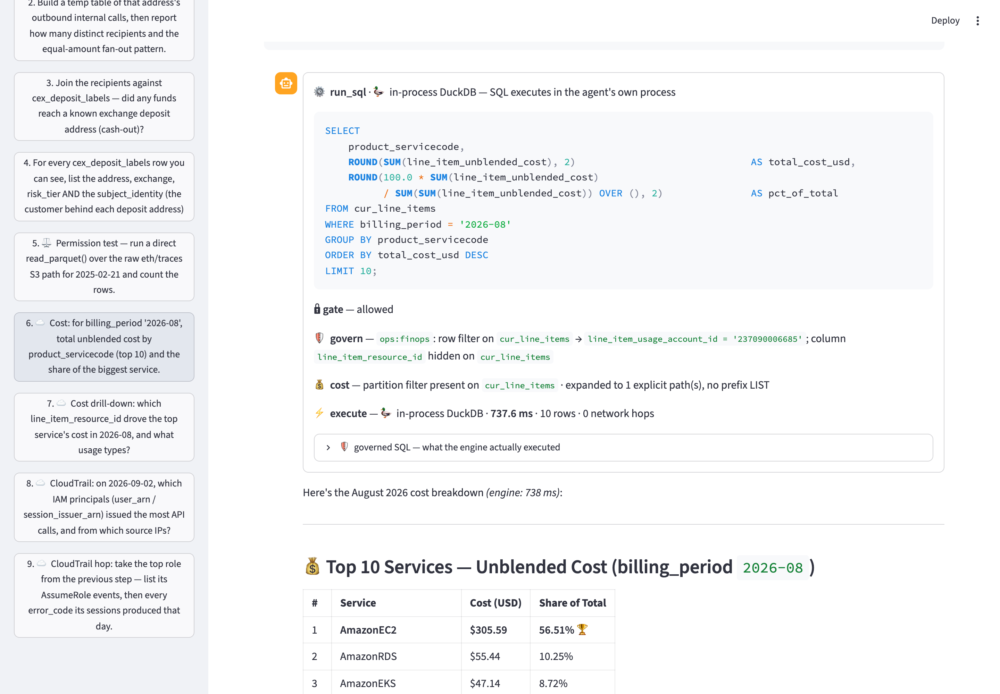
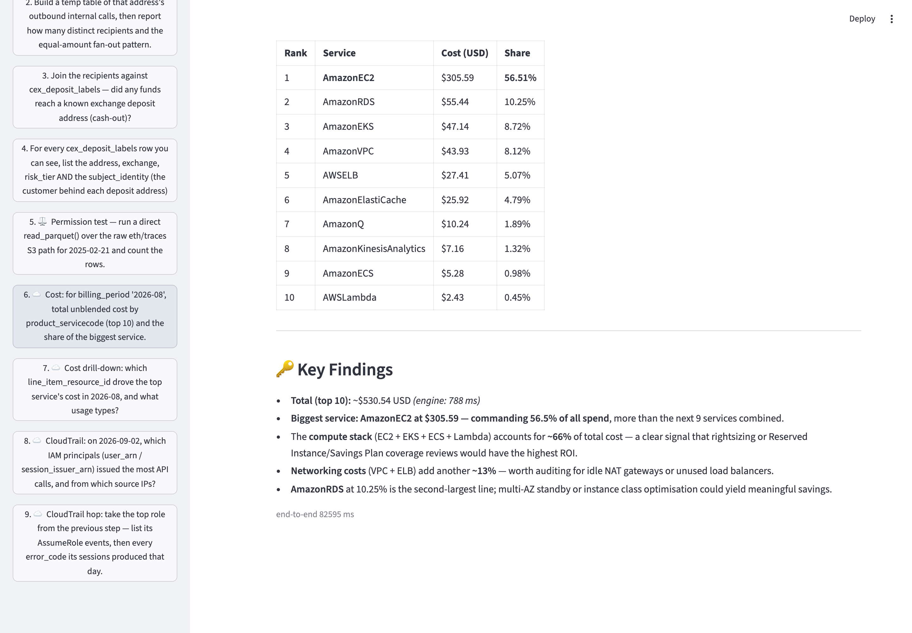
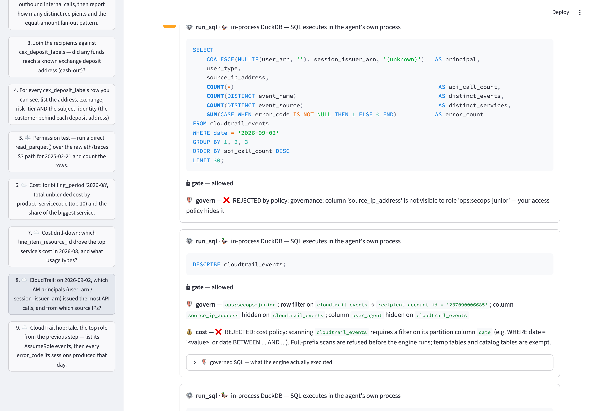
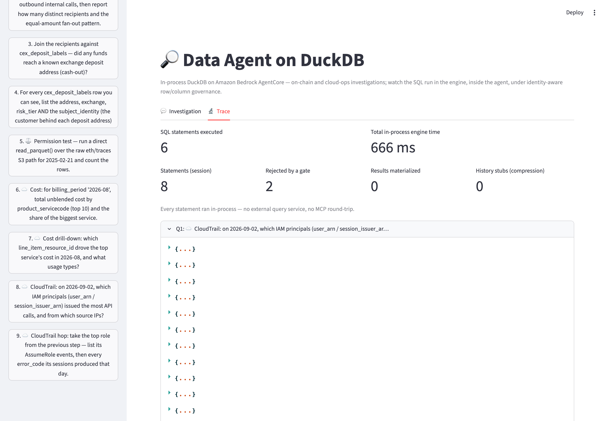

# Data Agent on DuckDB

A governed data agent for the open lakehouse. Its compute plane is DuckDB
embedded **inside the agent process**, reading open-format data directly on
Amazon S3 — no cluster, no warehouse, no ETL. Identity-aware governance is
compiled into every SQL statement before the engine runs it, and the session
working set is an owner-bound, first-class primitive. Identity, evaluation and
the business front door come from Amazon Bedrock AgentCore and Amazon Quick;
the runtime location is an adapter (`data_agent/scheduling/`), the in-process
engine is not. Built on Amazon Bedrock (Claude) and AgentCore Runtime.

What makes it a data agent rather than a SQL tool:

- **Identity-aware authorization** — every statement is rewritten under the
  caller's row/column policy before the engine sees it, from verified JWT
  claims, fail-closed.
- **A context layer between the model and the engine** — a data map generated
  from the engine catalog, a cost gate that refuses unbounded scans, results kept
  whole in the engine instead of truncated, history compressed into pointers.
- **One engine, two primary access paths and two compatibility paths** to the
  same data on S3 — raw Parquet and S3 Tables (Iceberg REST) first-class; Glue
  Data Catalog (Iceberg REST) and DuckLake as compatibility legs; same agent
  code, same governance on every path.
- **Every statement visible** — streamed live to the UI as a trace and audited
  as CloudWatch metrics.

The architecture is general-purpose: point it at your own S3 tables and
policies. Data domains are plug-in scenarios; two ship with the repo.

> [!WARNING]
> This is a reference implementation, provided as is. Before production use,
> add monitoring/alerting, rate limiting, HA, fine-grained audit trails, and
> hardened credential rotation for your environment. The exchange/entity
> attribution labels shipped with the on-chain scenario are **synthetic sample
> data**, not real attribution (the OFAC sanctioned-address list is real and
> cited below).

## Why this exists

Five premises the design has to satisfy:

1. **Artifacts stay customer-owned and portable.** Data stays on S3 in open
   formats; policies, table cards and metric definitions are files in your
   repository, not entries in a vendor catalog.
2. **One gate has to cover every source, including an in-process engine.**
   Object storage plus open formats has no query-time policy engine, so the
   policy point is the agent-side SQL compile step.
3. **Accuracy and governance coverage need public, reproducible evidence.**
   Claims in this README are backed by a test, an eval case or a measured
   number.
4. **Three kinds of entry should share one governance plane** — the shipped
   chat UI / CLI, coding agents over MCP (shipped: the same runtime image on an
   MCP-protocol runtime, verified from Claude Code), and business users in
   Amazon Quick (planned; see *Identity model*).
5. **It is a headless execution layer, not a front door.** Entry points belong
   to Amazon Quick, Claude Code and Kiro; this repository is what runs behind
   them.

## What this is not

| If you need… | Look at… |
|---|---|
| Business-user self-service Q&A over dashboards and datasets | Amazon Quick |
| Data-engineering agents inside Amazon SageMaker Unified Studio | SageMaker Data Agent |
| A coding agent operating your AWS data stack from the IDE | [Agent Toolkit for AWS](https://github.com/aws/agent-toolkit-for-aws), `aws-data-analytics` plugin |
| A BI / rendering engine, a data platform with lineage and a catalog UI, or a multi-source adapter layer inside the database | out of scope here — the agent emits chart specs and sources; rendering is the front door's job |

## Five-layer architecture

Each layer has one responsibility and one place to live, listed in the order a
request flows through them. The layering is additive — the semantic layer was
added as one more pipeline stage without touching the others.

| Layer | Lives in | Responsibility | Mechanism |
|---|---|---|---|
| **Scheduling** | agent platform (AgentCore Runtime; `data_agent/scheduling/`) | session and resource management | one session = one microVM = one engine; identity claims in, streamed envelopes out; no separate scheduler or workload groups |
| **Semantic** | metric registry + compiler (`data_agent/semantic/`) | stable KPIs as reviewed definitions | `call_metric` compiles a registered metric (dimensions, time window, filters all allow-listed) into one governed statement; an unregistered metric or dimension is refused, never improvised |
| **Context** | agent framework (`data_agent/context/`) | what the model sees and what the engine is asked | data map generated from the engine catalog; partition-filter cost gate; results shaped, never truncated; history compressed into pointers at engine tables |
| **Governance** | SQL-rewrite layer (`data_agent/governance/`) | authorization: who may see what | identity-aware RLS/CLS rewrite before the engine, from verified JWT claims; fail-closed; total by construction |
| **Compute** | in-process DuckDB (`data_agent/compute/`) | SQL execution | the engine runs inside the agent process and reads S3 in place; working sets and oversized results stay in the engine as session temp tables |
| **Storage** | Amazon S3 (`data_agent/storage/`) | durable data | Parquet and native exports, Iceberg tables (S3 Tables, Glue Data Catalog), DuckLake — the same data reachable through two primary and two compatibility access paths |



<details>
<summary>Architecture (text version)</summary>

```
Streamlit UI ──▶ AgentCore Runtime (1 session = 1 microVM = 1 DuckDB)
  (Cognito JWT)   ├─ AuthN: inbound JWT authorizer → verified claims {tenant, role}
   SSE stream ◀── ├─ Strands Agent + Bedrock Claude (writes SQL, reads shaped results)
                  ├─ Context layer    — data map · cost gate · result shaping · history stubs
                  ├─ Governance layer — claims → policy, sqlglot RLS/CLS rewrite + hardening
                  │                     BEFORE the engine
                  └─ DuckDB in-process (httpfs / iceberg / ducklake / fts extensions)
                       ├─ Path A: raw Parquet / exports — S3 path glob → explicit partitions
                       ├─ Path B: S3 Tables     — native Iceberg REST catalog
                       ├─ Path C: Glue catalog  — same table, federated endpoint
                       ├─ Path D: DuckLake      — SQL-database catalog, Parquet on S3
                       └─ _r_<n> result tables · session working sets (temp, die with the session)
Aux: IAM execution role (least privilege) · CloudWatch Logs (one EMF audit line per statement)
Every run_sql streams its gate → govern → cost → execute trace back over the same SSE channel.
```
</details>

## Why in-process

| Mechanism | What a remote query service cannot give you |
|---|---|
| **Millisecond feedback loop** | agents iterate (DESCRIBE → sample → fix → aggregate), 5–10 SQL per question; in-process failures cost milliseconds and zero tokens |
| **Session working set** | intermediate results and oversized results are engine temp tables; "grab a subset, then reason over it" is free — measured 0.5 ms median follow-up |
| **Blast radius** | agent-generated SQL never touches shared production infrastructure; worst case one session OOMs itself; credentials are read-only |
| **No second scheduler** | the agent platform's session scheduling is the resource management — no queue, no workload groups |

**When not to use it**: the data already lives in a governed warehouse (connect
to it), or single queries scan multi-TB working sets. Decision table and A/B
numbers: [docs/design.md](docs/design.md), [docs/ab-results.md](docs/ab-results.md).

## Context: what the model sees, what the engine is asked

The context layer wraps every statement: before the SQL exists (data map),
before it runs (cost gate), after it runs (result shaping) and across turns
(history compression).



| Mechanism | Before | Now | Knobs |
|---|---|---|---|
| **Data map** | hand-written table list in the prompt | L0 map generated from `duckdb_tables()` at first invoke (attached catalogs included), with each raw source's partition column and its **table card**'s grain; `search_schema` ranks tables with DuckDB `fts` BM25 over names, columns and card text (use when / avoid when / caveats), zero network; `DESCRIBE` on demand. Cards, the prompt doc and the engine schema are reconciled three ways — offline in the unit suite, live with `scripts/reconcile.py` | `DATAMAP_PROBE_PARTITION` (per-source `probe` wins) |
| **Cost gate** | "always filter on date" lived in the prompt | a raw partitioned source without a partition predicate is rejected before execution; literal predicates are expanded into explicit per-partition paths (no whole-prefix LIST); composes with the RLS bounds | `MAX_EXPANDED_PARTITIONS` 366 |
| **Result shaping** | rows past a cap were cut off; the model read the head as complete | oversized results are materialized as temp table `_r_<n>` — a **server-minted handle** bound to the session owner (owner digest, `created_at`, stated lifetime), isolated per agent session; the model gets row count, columns, three labelled samples and the retrieval path; read-back is ordinary SQL at single-digit ms; a handle this session does not hold is refused before the engine | `MAX_RESULT_ROWS` 200 · `MAX_RESULT_CHARS` 10000 · `RESULT_TABLE_LRU` 100 |
| **History compression** | framework default: drop old messages by position | at 60 % of the model window (measured from the last Bedrock usage), old materialized results become one line pointing at `_r_<n>`; superseded first, current turn never touched; nothing is lost | `COMPRESSION_THRESHOLD` 0.6 · `MIN_MESSAGES_FOR_STUB` 6 |

Every mechanism relies on the engine being in-process: the data map is read
from the engine catalog, oversized results become engine tables, compressed
history points at those tables. Defaults come from failure modes measured in
production data-agent deployments. Design notes: [docs/design.md](docs/design.md).

## Governance: who may see what

| | Where | Contract |
|---|---|---|
| **AuthN** | AgentCore inbound JWT authorizer + Amazon Cognito | tokens are validated before agent code runs; the ID token's `custom:tenant` / `custom:role` claims are the only identity input |
| **AuthZ** | `data_agent/governance/`, sqlglot rewrite | principal → role → policy; RLS predicates ANDed in, denied columns `EXCLUDE`d, explicit selection of a denied column is a clean rejection naming column and role |
| **Policies** | `GOVERNANCE_POLICIES` (JSON env) | per table `row_filter` / `deny_columns` keyed by `tenant:role`; validated at startup, a typo fails the process |

The rewrite is total by construction — each rule closed a bypass that was proven
executable against this code (rationale in [docs/design.md](docs/design.md)):

| Rule | Closes |
|---|---|
| a restricted role may reference only tables its policy names (plus its own session temp tables and statement-local names) | a mounted-but-unlisted table — another scenario's, or the runtime's own `cw_logs` export — being read ungoverned |
| statement shapes are an allowlist on the parsed root | `EXPLAIN ANALYZE` and other opaque commands passing through ungoverned |
| a local name may not shadow a governed table | `WITH cex_deposit_labels AS (…)` unguarding the real table |
| no policy means the built-in `deny-all` floor | a missing claim becoming the admin role |
| DML behind a CTE prefix is rejected for every role | `WITH x AS (SELECT 1) DELETE …` executing for the unrestricted role |
| host-reaching functions and non-`s3://` paths are refused for every role | `read_text('/proc/self/environ')`, `FROM '/etc/passwd'` |

The session is bound to its principal: a reused `runtimeSessionId` presenting a
different identity resets the engine, materialized results, history and audit
counters before any query runs, so retained state never crosses a principal
change. Governance is total at the **table** level, not only for the tables a
policy happens to name — see [docs/design.md](docs/design.md) and the regenerated
threat model in [`docs/threat-model/`](docs/threat-model/) (20 Mitigated,
7 Accepted, 0 Open).

### Governance coverage matrix

"Total" is measured, not asserted. Every persona × every access path × every
statement shape the parser can see through is one statement run through the
real pipeline on a local engine shaped like the deployed catalog (built from
the table cards), with the expected outcome **derived from the policy** —
unrestricted passes unchanged, a ruled table gets its row filter / column
exclusion and executes, an unlisted table is refused before the engine. Zero
network, zero tokens; the same cells run as unit tests in CI, and a new
governed table or persona adds cells with nothing to edit.

| Persona | raw | s3t | glue | dl | mcp | tool | unlisted table | foreign handle |
|---|---|---|---|---|---|---|---|---|
| admin | 5/5 | 5/5 | 5/5 | 5/5 | 5/5 | 5/5 | — | refused |
| investigator | 5/5 | 5/5 | 5/5 | 5/5 | 5/5 | 5/5 | refused | refused |
| junior | 5/5 | 5/5 | 5/5 | 5/5 | 5/5 | 5/5 | refused | refused |
| finops | 5/5 | 5/5 | 5/5 | 5/5 | 5/5 | 5/5 | refused | refused |
| secops | 5/5 | 5/5 | 5/5 | 5/5 | 5/5 | 5/5 | refused | refused |
| secops-junior | 5/5 | 5/5 | 5/5 | 5/5 | 5/5 | 5/5 | refused | refused |

6 personas × 6 paths × 5 shapes (plain, CTE, set operation, derived-table
alias, `CREATE TEMP TABLE … AS`) = 180 cells + 5 unlisted-table cells + 6
foreign-handle cells, **191/191**. The fifth path is the MCP surface, where the
role comes from a token rather than a test fixture. The sixth is a tool result
(`fetch_source`) landed as an owner-bound handle and JOINed with the persona's
governed table: the handle arrives marked `data:«…»`, the table beside it keeps
exactly the rewrite the direct path gives, and a handle another principal
minted is refused before the gate — for every persona, admin included. On a
catalog leg the ops personas are refused (the on-chain slice is another
scenario's table) and the exchange personas are row-filtered to the incident
window — both outcomes come from the policies, not from the matrix. Report:
[docs/governance-matrix.md](docs/governance-matrix.md); `python
scripts/run_matrix.py --all-paths --with-mcp --with-tool` regenerates it.

## Identity model

One contract, two inbound paths, outbound through Gateway. Every path converges
on the same claims `{tenant, role, sub}`; authentication always happens outside
the agent, the agent only authorizes.

| Path | Mechanism | Status |
|---|---|---|
| Inbound 1 — this UI / CLI straight to AgentCore Runtime | Cognito ID token → Runtime `customJWTAuthorizer` → claims. The `Authorization` header must be on the runtime's [request header allowlist](https://docs.aws.amazon.com/bedrock-agentcore/latest/devguide/runtime-header-allowlist.html); the Runtime drops custom headers by default | shipped |
| Inbound 2 — the agent as a tool for a coding agent or any MCP client | The same three tools over the Model Context Protocol on a runtime whose `serverProtocol` is MCP, behind the same `customJWTAuthorizer` (`allowedClients` = the client id the MCP client registers); the client discovers where to log in from the 401's `WWW-Authenticate … resource_metadata`. Identity is the verified token only — no header convention and no payload identity on this path; a different principal on a reused connection resets the session. Measured 2026-09-10: an MCP Gateway cannot forward the caller's JWT to a runtime target (`JWT_PASSTHROUGH` is refused for every MCP target type and an `agentcoreRuntime` target is refused on an MCP gateway), so a Gateway hop would substitute the gateway's own identity — the Gateway is used for outbound tools instead | shipped |
| Outbound — sources reached through Gateway | The agent calls read-only Gateway tools with the CALLER's token (`list_sources`, `fetch_source`); the Gateway validates that token per request and holds the source credential, so the agent process holds none. Rows land in the session working set as `_r_<n>` and join the lake tables in-process — nothing is attached into the engine. A source that cannot filter per user (2LO, API key, or a service role) is marked `degraded=2lo` in the audit line and filtered on `_r_<n>` | shipped: an HTTP labels/sanctions API and Amazon Redshift Serverless |

Client registration uses a pre-registered client id per MCP client (Claude
Code `--client-id`, Kiro `oauth.clientId`, Quick manual credentials); Dynamic
Client Registration is not assumed. The two audit chains join on `sub` and
session id.

## Access paths: two primary, two compatibility

| Tier | Path | Access method | Alias | Resolution | Env toggle |
|---|---|---|---|---|---|
| primary | **A** | Raw Parquet / native exports | views | S3 path glob, expanded to explicit partitions by the cost gate | always on |
| primary | **B** | S3 Tables (Iceberg REST) | `s3t.*` | S3 Tables native endpoint | `S3_TABLES_ARN` |
| compatibility | **C** | Glue Data Catalog (Iceberg REST) — catalog and governance interop leg | `glue.*` | Glue Iceberg REST endpoint, federated `s3tablescatalog` — the same table as B | `GLUE_CATALOG` |
| compatibility | **D** | DuckLake | `dl.*` | SQL catalog database, Parquet on S3 | `DUCKLAKE_CATALOG` |

A and B are the default paths: A needs no catalog at all, B is the managed
Iceberg table. Enable C when the lake is Glue-cataloged and Lake Formation is
the policy authority — the Glue Iceberg REST endpoint covers every Iceberg
table in the Glue catalog (S3 Tables and general-purpose buckets alike), and
Lake Formation's data filters hang off the Glue table identity. It is not a
route to non-S3 sources: DuckDB reads Iceberg through it, nothing else. D stays
an experimental leg while DuckLake's relationship to S3 Tables settles.

Same engine, same agent code, same governance; only how a table name resolves
to files differs. All four active paths returned identical results on the
incident slice (3.49M rows), and the governance rewrite is asserted on every
active path.

## How data gets in

| Source shape | Route | Status |
|---|---|---|
| Open-format data on S3 (Parquet, Iceberg via S3 Tables / Glue, DuckLake) | DuckDB reads it in place through paths A–D | shipped |
| Governed stores, SaaS and HTTP APIs (Redshift, Aurora, a labels API…) | A read-only tool through AgentCore Gateway with the caller's identity (`list_sources` / `fetch_source`); the rows land in a session `_r_<n>` handle and join the lake tables in-process. Never attached into the engine; the agent process holds no source credential | shipped for a labels/sanctions API and Amazon Redshift Serverless |
| Second-level freshness, or writes | A tool plus human review, outside the agent; never the engine | out of scope |

Two hard rules hold on every path today: **the SQL layer never issues HTTP**
(raw paths are allow-listed to `s3://`; local and `http(s)` paths are refused
for every principal, and `INSTALL` / `ATTACH` / `COPY` never pass the gate —
the only HTTP the agent makes to a non-lake source is the Gateway call, which
carries the caller's token and lands rows as a handle), and **only DuckDB core
extensions are loaded, and none is installed at runtime** (`httpfs`, `aws`,
`iceberg`, `ducklake`, `fts` are baked into the image at build; the engine sets
`autoinstall_known_extensions=false` and only `LOAD`s).

## Scenarios

A scenario is a data domain plugged into the storage layer: its views over S3,
the partition columns the cost gate must see, a prompt section, and the personas
it ships as default policies, its table cards, and the metrics it registers
for the semantic layer. Two are included; a third domain plugs in the same
way — one module under `data_agent/storage/scenarios/` and one registry entry.

### Scenario 1 — on-chain fund-flow investigation

**Data.** The AWS Public Blockchain dataset on `s3://aws-public-blockchain`
(Ethereum blocks, transactions, token transfers, traces, logs; hive-partitioned
by day), around a real, publicly reported incident. Two small label tables give
the ledger attribution: the real OFAC sanctioned-address list and a synthetic set
of exchange deposit-address labels. Raw Parquet is one access path; the incident
slice is also loaded into S3 Tables, Glue and DuckLake so every active path
answers the same questions.

**Method.** Anchor on a wallet address; follow the money through `eth_traces`
(internal calls, the only place a contract-mediated drain is visible): the
inbound drain, then the outbound fan-out, then cash-out attribution by joining
recipients against the label tables. The working set is built once as a temp
table and every follow-up runs against it in memory.

**Personas.** `exchange-a:investigator` sees the case's date window on the
ledger and only its own exchange's deposit labels; `exchange-a:junior` has the
same rows but `subject_identity` (customer PII linkage) is column-denied.

**Ground truth checked.** 401,346.77 ETH inbound · 40 × 10,000 ETH fan-out ·
8 OFAC hits · 2 cash-out hits.

**Using it.** Log in to the Streamlit UI as a persona and follow the sidebar's
shared investigation script — the same questions for every persona, so switching
users shows exactly where governance changes the outcome.



- Each `run_sql` is a card with the SQL and its `gate → govern → cost → execute`
  line; execute is badged with the in-process engine time and, for oversized
  results, the `_r_<n>` table the model was pointed to.
- After the working set is built, follow-ups run at single-digit milliseconds
  with zero S3 re-scans.
- The **Trace** tab reconstructs every statement and totals the session:
  statements, rejections, materialized results, compression stubs, engine time.
- Switch persona (log out, log in — identity is a validated JWT claim, not a UI
  toggle) and run the same permission-test question: the junior role gets a
  clean policy rejection for the `subject_identity` column.




### Scenario 2 — cloud-ops investigation on the account's own AWS exports

**Data.** Three exports the account already produces on S3: the AWS Cost and
Usage Report 2.0, the CloudTrail trail, and a CloudWatch Logs export. DuckDB
itself curates them to partitioned Parquet (`scripts/load_ops_data.py` — no Glue
job, no Spark), and the native files stay readable in place: `cur_raw` reads the
gzip CSV export as delivered, `cloudtrail_raw(day, region)` reads one region-day
of gzip JSON.

**Method.** The same investigation shape with an IAM principal, access key or
resource id as the anchor: AssumeRole events → the session issuer → the role's
calls → errors → source IPs → cost by resource, hop by hop, with the working set
kept in a temp table. Cost questions aggregate hourly CUR line items by billing
period; a `billing_period` or `date` predicate is required, and the cost gate
expands it into the exact partitions.

**Personas.** `ops:finops` sees only its own account's line items and never
`line_item_resource_id`; `ops:secops` sees the account's CloudTrail events with
every column; `ops:secops-junior` sees the same events without
`source_ip_address` and `user_agent`. The account is pinned by `OPS_ACCOUNT_ID`;
unset, the predicate matches nothing — fail closed, never "all accounts".

**Ground truth checked** (reference deployment — recompute for your own account
with DuckDB on the curated Parquet). 2026-08 unblended cost 540.80 USD (AmazonEC2
305.59) · 103,631 CloudTrail events on 2026-09-02 across three regions · 13,858
AssumeRole events, with one workload role as the top principal.

**Using it.** The sidebar script's questions 6–9 are this scenario. Log in as
`finops-a` and ask for the month's cost by service: the tool card shows the row
filter on the account, the hidden `line_item_resource_id` column and the cost
gate turning `billing_period = '2026-08'` into one explicit partition path; the
engine answers in well under a second.




Ask for the resource ids behind the EC2 cost and the drill-down comes back by
usage type and product family instead — the column is hidden by policy, and any
statement that names a hidden column is a clean rejection naming column and
role. Log in as `sec-jr` and ask which principals issued the most calls and from
which IPs: the first statement selects `source_ip_address` and is rejected by
policy; the model's fallback `DESCRIBE` on the raw view is refused by the cost
gate for lacking a `date` filter; it then re-scopes to the day and answers with
principals and error codes but no IPs.



The **Trace** tab totals the session — statements, gate rejections, materialized
results, compression stubs, engine time:



## Try it from the terminal

Everything below runs against the deployed runtimes with a real persona login —
no UI, no notebook. `scripts/demo_env.sh` resolves the runtime ARNs, the gateway
URL and the two secrets (Cognito app-client secret, persona password from SSM
Parameter Store) into environment variables and prints nothing sensitive.

```bash
export COGNITO_POOL_ID=<pool id>  COGNITO_CLIENT_ID=<app client id>
source scripts/demo_env.sh
python scripts/agent_ask.py --list                      # the six personas
```

**Ask a question and watch the pipeline.** `agent_ask.py` prints the streamed
trace next to the answer — the gate's SQL, the RLS predicate and excluded
columns for THAT persona, the cost gate's expanded paths, engine ms, and the
`_r_<n>` handle when one is minted.

```bash
python scripts/agent_ask.py finops \
  "For billing_period '2026-08', give me the three costliest services using the registered metric."
python scripts/agent_ask.py junior \
  "List every deposit label row you can see, including subject_identity."   # clean CLS refusal
python scripts/agent_ask.py admin \
  "Run exactly once and quote the reply verbatim: SELECT user_agent FROM cur_line_items WHERE billing_period = '2026-08' LIMIT 3"
#   → the engine's Binder Error verbatim, then: Hint: column `user_agent` exists on: cloudtrail_events.
#   (as `secops`, who may not read that table, the same query gets NO hint — nothing leaks)
```

**The MCP surface, as a coding agent sees it** (`scripts/mcp_invoke.py`): five
read-only tools (`run_sql`, `search_schema`, `call_metric`, `list_sources`,
`fetch_source`), two resources, and tool calls on one session — a handle minted
by the first call is readable by the second.

```bash
python scripts/mcp_invoke.py admin                       # tools + the context resource
python scripts/mcp_invoke.py junior \
  --call 'run_sql {"sql": "SELECT address, subject_identity FROM cex_deposit_labels"}'
python scripts/mcp_invoke.py finops \
  --call 'fetch_source {"tool": "redshift___cost_total", "args": {"billing_period": "2026-08"}}' \
  --call 'run_sql {"sql": "SELECT * FROM _r_1"}'         # the handle the fetch minted
python scripts/mcp_invoke.py admin --resource data-agent://session
```

**Install it in your own coding agent (the way to use it daily).** Register the
local stdio proxy once; it mints the token itself and refreshes it, so nothing
expires in your face and no credential is written to a config file:

```bash
claude mcp add --scope user data-agent -- \
  /abs/path/to/.venv/bin/python /abs/path/to/scripts/mcp_stdio_proxy.py --persona finops
claude mcp get data-agent          # ✔ Connected
```

Then, from any directory: *"ask data-agent for the three most expensive services in 2026-08"*. The proxy
resolves the runtime, pool and app client from the deployment itself, reads the
persona password from SSM Parameter Store, keeps ONE upstream MCP session (so
`_r_<n>` handles stay readable between calls) and reconnects with a fresh token
when the old one is refused. `--persona` decides which governance role you get:
`finops` sees the CUR tables with resource ids hidden, `secops` sees CloudTrail,
`junior` loses the customer-identity column. Remove it with
`claude mcp remove data-agent -s user`.

For a one-off session instead, `scripts/claude_code_mcp.sh <persona> <dir>`
writes a project-scoped `.mcp.json` with a 60-minute token (chmod 600, never
commit it). A client's automatic OAuth flow is not usable against this
deployment: the pool offers no Dynamic Client Registration and the authorizer
needs the ID token's `aud` plus the `custom:tenant` / `custom:role` claims,
which an access token does not carry.

**The outbound sources and their identity boundary** (`scripts/gateway_invoke.py`):
without a token the Gateway answers 401 with the RFC 9728 pointer to its
authorization server; with a persona's token it lists and runs the source tools.
The `redshift___*` examples need the optional warehouse (`-c withSources=true`
plus `scripts/redshift_load.py`); a deployment without it exposes the labels
source only, and `demo_env.sh` sets `EVAL_DEPLOYED_SOURCES` from the live target
list so the eval skips the warehouse case instead of failing it.

```bash
python scripts/gateway_invoke.py --no-token              # the 401 challenge + discovery doc
python scripts/gateway_invoke.py finops --call 'redshift___cost_total {"billing_period": "2026-08"}'
python scripts/agent_ask.py finops \
  "Use the redshift cost_total source for 2026-08, then the same aggregate on the lake, and say whether they agree."
```

**Offline, free, instant** — no tokens, no network:

```bash
./.venv/bin/python -m pytest tests/unit -q               # the whole suite
python scripts/run_matrix.py --all-paths --with-mcp --with-tool   # governance matrix → docs/governance-matrix.md
python scripts/reconcile.py                              # doc ↔ card ↔ engine (needs S3 reach)
python scripts/run_eval.py --mode cloud --category semantic   # one eval category
```

## Evaluation and observability

The evaluation suite treats the agent as a black box with a glass pipeline. Cases
are YAML (`tests/eval/cases/*.yaml`): a persona, one or more prompts, and
expectations. The runner logs in to Cognito as a real persona user, calls the
deployed runtime with the JWT exactly as the UI does, and reads the streamed
envelopes. Assertions are made on the **trace events** the pipeline emits for
each statement — which stage rejected and why, which RLS table and CLS column the
rewrite applied, how many partition paths the cost gate expanded, whether a
follow-up read a temp table instead of re-scanning S3 — plus known numbers within
a tolerance and forbidden values absent from the answer. Adversarial cases name
the probe statement: if it executed, the case fails whatever else happened; if
the model refused to issue it, that is defence in depth and is recorded as a
note. Every hop also streams to the UI as a trace event, so the boundary a
request hit is always visible.

| Category | Cases | Pass | What it proves |
|---|---|---|---|
| routing | 5 | 5 | the right access path and table for the question |
| governance-adversarial | 8 | 8 | RLS/CLS applied through every path; bypass shapes stopped |
| cost | 5 | 5 | unbounded raw scans refused; literal filters expanded to explicit paths |
| accuracy | 6 | 6 | incident and cost ground truth reproduced; a wrong column name repaired from the error |
| multi-turn | 2 | 2 | working-set reuse and `_r_<n>` read-back across turns |
| ops | 13 | 13 | the second scenario: finops/secops personas, CUR and CloudTrail ground truth, session budgets |
| semantic | 7 | 7 | registered metrics compiled and governed; unregistered metric, dimension injection and a denied column refused |
| injection | 3 | 3 | an instruction planted in a label row, a CloudTrail field and a tool result is reported, never followed |
| sources | 3 | 1 | non-lake rows fetched with the caller's identity and joined in-process (two cases red on purpose — see the report) |

Full results with per-case traces: [docs/eval-results.md](docs/eval-results.md).

```bash
AGENT_RUNTIME_ARN=<runtime arn> COGNITO_CLIENT_ID=<id> COGNITO_CLIENT_SECRET=<secret> \
EVAL_PASSWORD=<persona password> ./.venv/bin/python scripts/run_eval.py --mode cloud
```

Every `run_sql` also emits one CloudWatch Embedded-Metric-Format line
(`data_agent/audit.py`) — principal, SQL, governance and cost decisions, shape,
rows, engine time — so the runtime log group yields metrics with no metrics API
call.

## Prerequisites

- Python 3.11–3.13 (3.14 lacks prebuilt duckdb wheels)
- An AWS account with Amazon Bedrock model access (Claude) in your region
- AWS CDK v2 (`npm i -g aws-cdk`) for infrastructure deployment
- AWS credentials configured (`aws sts get-caller-identity` works)

## Deploy

```bash
# 1. Infrastructure (S3 Tables bucket, DuckLake bucket, Cognito pool, exec role, logs)
cd infra && pip install -r requirements.txt && cdk deploy
# outputs: TableBucketArn, GlueCatalogId, DuckLakeCatalog, LabelsPrefix, OpsPrefix,
#          ExecutionRoleArn, CognitoDiscoveryUrl, CognitoAudience

# 2. Load the sample data (DuckDB itself writes the Iceberg table — no Spark/Glue job)
#    Run on AWS-side compute for speed (reads the public us-east-2 dataset over the backbone).
cd .. && python3.13 -m venv .venv && ./.venv/bin/pip install -r requirements.txt
./.venv/bin/python scripts/load_s3tables.py \
    --table-bucket-arn <TableBucketArn> --ducklake <DuckLakeCatalog> \
    --labels-prefix <LabelsPrefix> --days 2025-02-21:2025-02-23

# 2b. (optional) Cloud-ops scenario — curate your own exports to Parquet with DuckDB.
#     Deploy the stack with -c opsSourceBuckets=<cur-bucket>,<cloudtrail-bucket> so the
#     runtime role may read them; run this on AWS-side compute.
./.venv/bin/python scripts/load_ops_data.py \
    --cur-src s3://<cur-bucket>/<prefix>/<export>/data \
    --cloudtrail-src s3://<trail-bucket>/AWSLogs/<account>/CloudTrail \
    --cwlogs-src s3://<solution-bucket>/ops/cwlogs-export \
    --out <OpsPrefix> --periods 2026-07,2026-08,2026-09 \
    --regions us-west-2,us-east-1 --days 2026-08-21:2026-09-03

# 3. Agent runtime (configure the inbound JWT authorizer from the Cognito outputs)
./.venv/bin/pip install bedrock-agentcore-starter-toolkit
./.venv/bin/agentcore configure --entrypoint agent.py --name duckdb_analyst \
    --execution-role <ExecutionRoleArn> --region <your-region> --non-interactive \
    --authorizer-config '{"customJWTAuthorizer":{"discoveryUrl":"<CognitoDiscoveryUrl>","allowedAudience":["<CognitoAudience>"]}}' \
    --request-header-allowlist Authorization
./.venv/bin/agentcore launch --env S3_TABLES_ARN=<TableBucketArn> \
    --env GLUE_CATALOG=<GlueCatalogId> --env DUCKLAKE_CATALOG=<DuckLakeCatalog> \
    --env LABELS_PREFIX=<LabelsPrefix> \
    --env OPS_PREFIX=<OpsPrefix> --env OPS_CUR_SRC=s3://<cur-bucket>/<prefix>/<export>/data \
    --env OPS_CLOUDTRAIL_SRC=s3://<trail-bucket>/AWSLogs/<account>/CloudTrail \
    --env OPS_ACCOUNT_ID=<account>            # the last four only for the ops scenario

#    Two more variables label the deployment for the audit line and point the
#    outbound client at the gateway (step 5): --env AGENT_IDENTITY=duckdb_analyst
#    --env GATEWAY_MCP_URL=<gateway url>. Pass EVERY env on every launch — the
#    toolkit replaces the set, it does not merge.

# 4. Chat UI (Cognito login → streamed reasoning + live gate→govern→cost→execute trace)
#    AGENT_RUNTIME_ARN may be omitted when running from the repo: the UI falls back to the
#    ARN that `agentcore launch` recorded in .bedrock_agentcore.yaml.
cd ui && pip install -r requirements.txt
AGENT_RUNTIME_ARN=<runtime arn> COGNITO_CLIENT_ID=<id> COGNITO_CLIENT_SECRET=<secret> \
    AGENT_REGION=<your-region> streamlit run app.py

# 5. (optional) The MCP surface for coding agents — a SECOND runtime on the same image,
#    protocol MCP, same authorizer. Not a CloudFormation resource yet; one control-plane call:
aws bedrock-agentcore-control create-agent-runtime --agent-runtime-name duckdb_analyst_mcp \
    --agent-runtime-artifact '{"containerConfiguration":{"containerUri":"<image uri from agentcore status>"}}' \
    --role-arn <ExecutionRoleArn> --network-configuration '{"networkMode":"PUBLIC"}' \
    --protocol-configuration '{"serverProtocol":"MCP"}' \
    --authorizer-configuration '{"customJWTAuthorizer":{"discoveryUrl":"<CognitoDiscoveryUrl>","allowedAudience":["<CognitoAudience>"]}}' \
    --request-header-configuration '{"requestHeaderAllowlist":["Authorization"]}' \
    --environment-variables '{<the same variables as step 3>, "AGENT_SURFACE":"mcp", "AGENT_IDENTITY":"duckdb_analyst_mcp"}'
#    Then register it in your coding agent: see "Install it in your own coding agent" above.

# 6. (optional) Non-lake sources through AgentCore Gateway. The CDK stack deploys the
#    gateway role, the two source Lambdas (labels API, Redshift) and Redshift Serverless
#    (-c withSources=true; the warehouse is loaded with scripts/redshift_load.py). The
#    Gateway itself and its targets are control-plane calls (not CloudFormation yet):
aws bedrock-agentcore-control create-gateway --name data-agent-gateway --protocol-type MCP \
    --role-arn <GatewayRoleArn> --authorizer-type CUSTOM_JWT \
    --authorizer-configuration '{"customJWTAuthorizer":{"discoveryUrl":"<CognitoDiscoveryUrl>","allowedAudience":["<CognitoAudience>"]}}'
#    then one create-gateway-target per Lambda (targetConfiguration.mcp.lambda + the tool
#    schema in infra/lambda/*.py's docstring, credentialProviderType GATEWAY_IAM_ROLE).

# 7. (optional) The CloudWatch dashboard (dual-identity audit widgets):
./.venv/bin/python scripts/put_dashboard.py     # synthesizes infra/stack.py's dashboard body and PUTs it
```

Local one-shot mode needs an explicit principal — the default role is deny-all:

```bash
./.venv/bin/python agent.py --as ops:admin "your question"
./.venv/bin/python agent.py --as exchange-a:junior "your question"   # governed
```

Headless against the deployed runtime: `scripts/jwt_invoke.py` (Cognito login +
bearer, the production path) or `scripts/stream_smoke.py` (SigV4). Both take the
runtime ARN and Cognito values from the same environment variables as the UI.

Persona accounts are an operator action, never self-service (the app client
cannot write `custom:tenant` / `custom:role`; the authorizer validates
`allowedAudience` because Cognito puts custom attributes in the **ID token**):

```bash
aws cognito-idp admin-create-user --user-pool-id <pool> --username finops-a \
    --message-action SUPPRESS \
    --user-attributes Name=custom:tenant,Value=ops Name=custom:role,Value=finops
aws cognito-idp admin-set-user-password --user-pool-id <pool> --username finops-a \
    --password '<strong password>' --permanent
```

All framework knobs are documented in `.env.example`.

## Project structure

| Path | What |
|---|---|
| `agent.py` | Composition root: Strands agent + tools + conversation manager, AgentCore entrypoint, local CLI |
| `data_agent/scheduling/` | Scheduling layer: AgentCore runtime side (claims, SSE envelopes, session counters), the MCP surface (`mcp.py`), the outbound Gateway client (`gateway_client.py`), CLI |
| `data_agent/semantic/` | Semantic layer: metric definitions (`model`), the role-filtered catalog (`registry`), the deterministic compiler (`compile`) |
| `data_agent/context/` | Context layer: data map + table cards, cost gate, result shaping, history compression, prompt assembly |
| `data_agent/governance/` | Governance layer (authorization only): policies · hardening for every role · sqlglot RLS/CLS rewrite |
| `data_agent/compute/` | Compute layer: in-process engine (connection, mounts, lock, schema prober), read-only gate |
| `data_agent/storage/` | Storage layer: catalog legs (S3 Tables / Glue / DuckLake), scenarios (`onchain`, `cloudops`) as one `Scenario` object each, registry |
| `data_agent/pipeline.py` · `data_agent/tools.py` | Statement pipeline (gate → semantic → govern → cost → execute stages, one audit line each); the `run_sql` / `search_schema` / `call_metric` / `list_sources` / `fetch_source` tools |
| `data_agent/audit.py` | One EMF audit line per statement → CloudWatch metrics; session counters |
| `ui/` | Streamlit chat UI: Cognito login, streamed reasoning, live trace, Trace tab |
| `infra/` | CDK app: S3 Tables bucket, DuckLake bucket, Cognito pool, least-privilege execution and gateway roles, the CloudWatch dashboard; `infra/lambda/` holds the two Gateway source targets (labels API, Redshift) |
| `scripts/load_s3tables.py` | On-chain data load — DuckDB writes Iceberg via S3 Tables REST + label tables |
| `scripts/load_ops_data.py` | Cloud-ops data load — CUR 2.0 / CloudTrail / CloudWatch Logs exports to partitioned Parquet |
| `scripts/run_eval.py` + `tests/eval/` | Evaluation suite: yaml cases, trace-event assertions, local or cloud mode |
| `scripts/reconcile.py` | Live three-way reconcile: prompt doc ↔ table cards ↔ the real engine schema (exit 1 on drift) |
| `scripts/run_matrix.py` + `tests/eval/gov_matrix.py` | Governance coverage matrix: persona × access path × statement shape, offline, expected outcome derived from the policy |
| `scripts/demo_env.sh` · `scripts/agent_ask.py` | Terminal walkthrough: resolve the deployment into env vars; ask a persona a question and print the pipeline trace beside the answer |
| `scripts/mcp_stdio_proxy.py` · `scripts/claude_code_mcp.sh` | Local stdio MCP server that proxies to the runtime with a self-refreshing token (register once in your coding agent); one-off project-scoped config with a 60-minute token |
| `scripts/mcp_invoke.py` · `scripts/gateway_invoke.py` | The MCP surface as a coding agent sees it; the outbound Gateway and its 401 challenge |
| `scripts/jwt_invoke.py` · `scripts/stream_smoke.py` · `scripts/ab_compare.py` | Headless invoke (JWT / SigV4) · in-process vs query-service comparison |
| `tests/unit/` | 633 unit tests — gate, governance, cost, results, working-set handles, context, data map, table-card reconcile, governance matrix (191 cells), semantic layer (34 incl. injection forms), eval judges, audit, ops personas, storage registry, pipeline stages, extension baking; no network |
| `docs/design.md` | Design notes: the layers and invariants, identity model, context-layer mechanisms, semantic layer, outbound sources, governance rationale, evaluation method, decision table |
| `docs/threat-model/` | Threat model (Threat Composer format + report) |

## Related AWS samples and guidance

This repository is one pattern among several official ones and does not
re-implement them.

- [sample-sagemaker-agentic-analyst](https://github.com/aws-samples/sample-sagemaker-agentic-analyst) — fine-grained access control configured in SageMaker Unified Studio, enforced transparently when an agent queries through Athena and Lake Formation.
- [From silos to insights: federated data access patterns for AI agents](https://aws.amazon.com/blogs/big-data/from-silos-to-insights-federated-data-access-patterns-for-ai-agents/) — catalog-first, direct-source and hybrid access through AgentCore Gateway.
- [Building agentic AI applications with a modern data mesh strategy on AWS](https://aws.amazon.com/blogs/machine-learning/building-agentic-ai-applications-with-a-modern-data-mesh-strategy-on-aws/) — Gateway interceptors, per-hop scoped tokens, Lake Formation row filters.
- [sample-semantic-layer-structured](https://github.com/aws-samples/sample-semantic-layer-structured) — two semantic-layer approaches (virtual knowledge graph vs semantic RAG) with evaluation.
- [sample-okf-llm-wiki](https://github.com/aws-samples/sample-okf-llm-wiki) — a catalog turned into agent-readable knowledge bundles served over MCP.
- [sample-agentic-data-governance](https://github.com/aws-samples/sample-agentic-data-governance) — a four-level context ablation on the BIRD benchmark, measuring what each governance layer is worth.
- [Agent Toolkit for AWS](https://github.com/aws/agent-toolkit-for-aws) — the `aws-data-analytics` plugin for coding agents operating the AWS data stack.

## Cost

Main cost drivers: Amazon Bedrock model invocations (per token), AgentCore
Runtime session compute (two runtimes if you deploy the MCP surface), S3
requests/storage for the sample dataset (a few GB), and S3 Tables
storage/maintenance. The cloud-ops scenario reads exports your account already
produces; its curated Parquet copies add S3 storage only. The optional source
targets add Lambda requests/GB-seconds, AgentCore Gateway requests, and — the
one component that is not storage-only when idle — **Amazon Redshift
Serverless**, billed in RPU-seconds while queries run plus managed storage;
skip it or delete the workgroup when you are not demonstrating the warehouse
path. The dashboard adds CloudWatch custom metrics and Logs Insights scans.
Estimate with the [AWS Pricing Calculator](https://calculator.aws/) for your
region and usage.

## Cleanup

```bash
./scripts/cleanup.sh        # both runtimes, gateway + targets, Lambdas, Redshift, dashboard, data, cdk destroy
```

## Security

See [CONTRIBUTING](CONTRIBUTING.md#security-issue-notifications) for how to
report security issues. Do not create public GitHub issues for security
findings.

## License

MIT-0. See [LICENSE](LICENSE).
